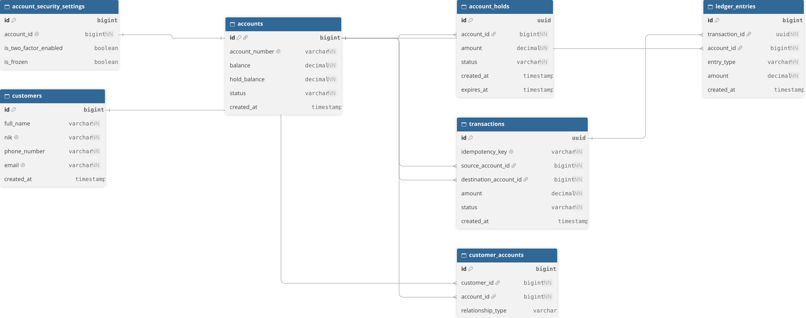

# 🏦 Financial Ledger Microservice (`ledger-service`)


`ledger-service` adalah *microservice* simulasi *Core Banking Ledger* berkinerja tinggi yang menangani pencatatan keuangan *double-entry bookkeeping*, penahanan saldo (*account holds*), serta eksekusi transaksi yang tangguh terhadap **konkurensi tinggi dan kebuntuan (*deadlock prevention*)**.

---

## 📌 Fitur Utama

- **Double-Entry Bookkeeping**: Setiap transaksi menghasilkan entri debit dan kredit yang seimbang untuk menjaga integritas data keuangan.
- **Deadlock Prevention (Lock Ordering)**: Penguncian baris database (`PESSIMISTIC_WRITE` dengan `FOR NO KEY UPDATE`) dieksekusi berdasarkan urutan ID akun terkecil untuk mencegah kondisi *circular wait* (`SQLSTATE 40P01`).
- **Hold Balance Management**: Mendukung alur penahanan dana sementara (`HELD`) hingga proses penyelesaian transaksi (*commit*).
- **Idempotency & Concurrency Control**: Mencegah pemrosesan ganda (*double spending*) pada request konkurensi menggunakan *Idempotency Key*.
- **Event-Driven Architecture**: Menerbitkan *event* transaksi secara *asynchronous* ke Apache Kafka.

---

## 📊 Entity Relationship Diagram (ERD)

[](docs/assets/erd-schema.svg)

> *Catatan: Klik gambar di atas untuk melihat diagram dalam ukuran penuh. Source file DBML dapat diakses di [`docs/database/schema.dbml`](docs/database/schema.dbml).*

---

## 🛠️ Tech Stack & Infrastruktur

- **Framework**: Spring Boot 3.2+ (Java 17)
- **Database**: PostgreSQL 16
- **Cache & Lock**: Redis 7
- **Message Broker**: Apache Kafka 3.6+
- **Testing**: JUnit 5, Pest / JMeter 5.6.3 (Concurrency Testing)

---

## 🚀 Setup & Cara Menjalankan

### 1. Prasyarat System

- Docker & Docker Compose
- Java OpenJDK 17+
- Apache JMeter (untuk uji beban/konkurensi)

### 2. Jalankan Environment via Docker

```bash
docker-compose up -d
```

Service yang berjalan:

- **PostgreSQL (Ledger DB)**: `localhost:5434`
- **PostgreSQL (Customer DB)**: `localhost:5432`
- **Apache Kafka**: `localhost:9092`
- **Redis**: `localhost:6379`

### 3. Build & Jalankan Application

```bash
mvn clean install
mvn spring-boot:run
```

Aplikasi berjalan pada port `http://localhost:8083`.

---

## 🔌 API Endpoints Reference

### Commit Hold Transaction

Memindahkan saldo yang ditahan (`hold_balance`) menjadi transfer efektif ke akun tujuan.

- **URL**: `POST /api/holds/commit`
- **Content-Type**: `application/json`

#### Request Body

```json
{
  "holdId": "11111111-1111-1111-1111-111111111111",
  "destinationAccountId": 1002
}
```

#### Success Response (`200 OK`)

```json
{
  "status": "SUCCESS",
  "message": "Hold committed successfully"
}
```

#### Error Response (`400 / 500`)

```json
{
  "timestamp": "2026-10-16T03:36:28.616Z",
  "status": 500,
  "error": "Internal Server Error",
  "message": "Terjadi kesalahan internal pada server"
}
```

---

## 🧪 Uji Konkurensi & Deadlock (JMeter)

Sistem ini diuji secara ketat menggunakan skenario **Cross-Transfer Simultaneous Executions** (Akun 1001 $\rightarrow$ Akun 1002 dan Akun 1002 $\rightarrow$ Akun 1001 pada milidetik yang sama).

### Reset Data Uji di PostgreSQL

```sql
UPDATE accounts SET balance = 1000.00, hold_balance = 300.00 WHERE id IN (1001, 1002);
DELETE FROM account_holds;
INSERT INTO account_holds (id, account_id, amount, created_at, expires_at, status)
VALUES
  ('11111111-1111-1111-1111-111111111111', 1001, 300.00, NOW(), NOW() + INTERVAL '10 minutes', 'HELD'),
  ('22222222-2222-2222-2222-222222222222', 1002, 300.00, NOW(), NOW() + INTERVAL '10 minutes', 'HELD');
```

### Eksekusi Uji Beban via CLI

```powershell
jmeter -n -t "LedgerDeadlock.jmx" -l "result_deadlock.jtl"
```

### Hasil Validasi

| Metric | Result Target | Status |
| --- | --- | --- |
| **Total Requests** | 2 Transaksi Silang | ✅ Passed |
| **Error Rate** | `0.00%` | ✅ Passed |
| **PostgreSQL Log** | No `SQLSTATE 40P01` (Deadlock) | ✅ Passed |
| **Hold Status Final** | `COMMITTED` | ✅ Passed |

---

