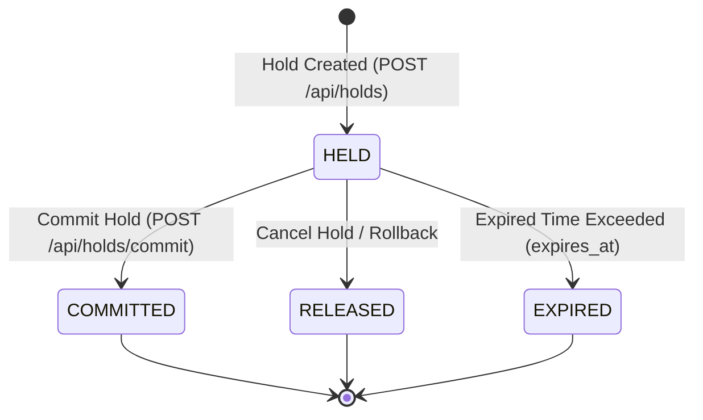
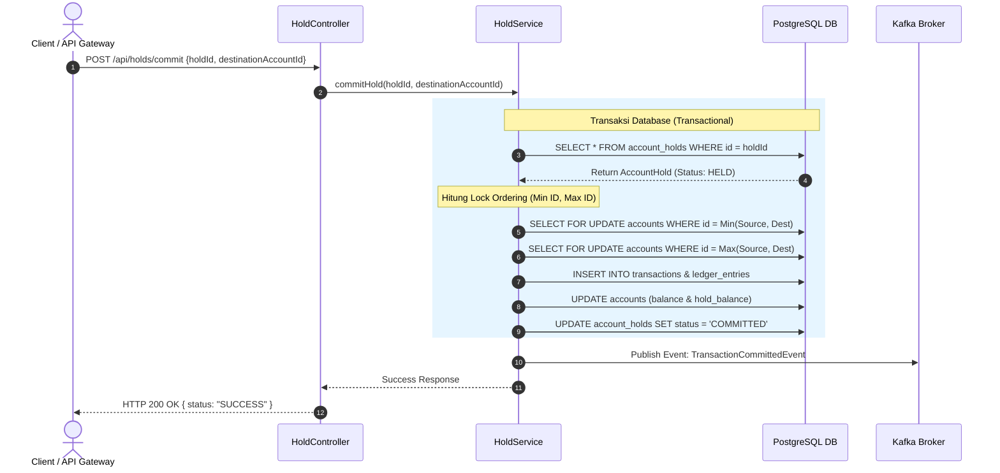

# Flow & State Machine Diagrams - Ledger Service

Dokumen ini menjelaskan alur data transaksi dan perubahan status penahanan saldo (*account holds*).

---

## 1. State Machine: Status Penahanan Saldo (`AccountHold`)

Setiap penahanan saldo memiliki siklus hidup status sebagai berikut:

### Keterangan Status:
* **`HELD`**: Saldo berhasil dikunci pada `hold_balance` akun asal. Total saldo tersedia (*available balance*) berkurang.
* **`COMMITTED`**: Dana penahanan berhasil dipindahkan ke akun tujuan secara eksekusi entri ganda (*double-entry ledger*).
* **`RELEASED`**: Penahanan dibatalkan secara manual; `hold_balance` dikembalikan ke akun asal.
* **`EXPIRED`**: Batas waktu penahanan habis sebelum di-*commit*.

---

## 2. Sequence Diagram: Commit Hold Request (`POST /api/holds/commit`)

